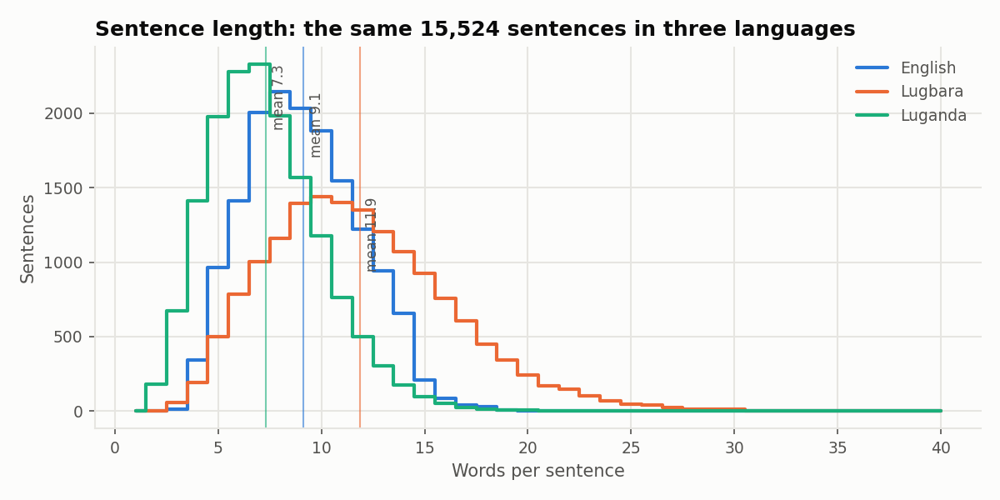
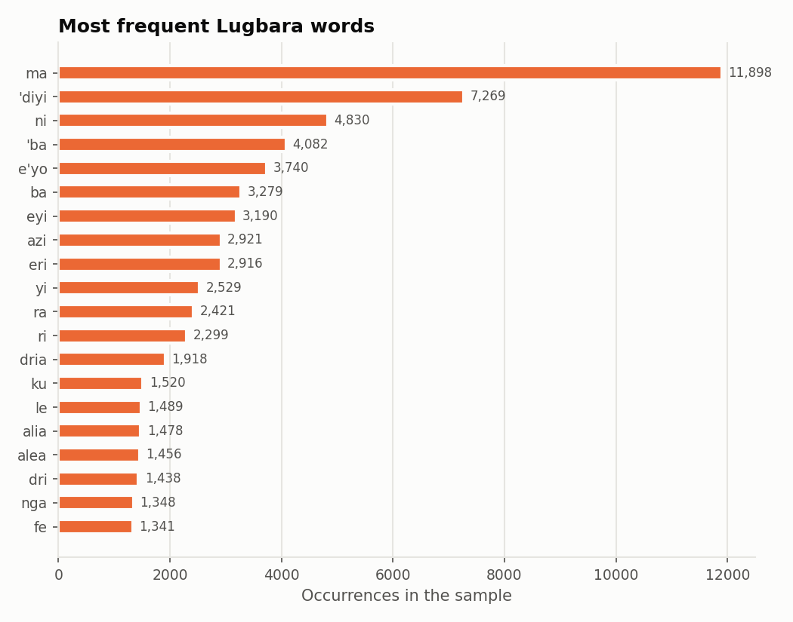
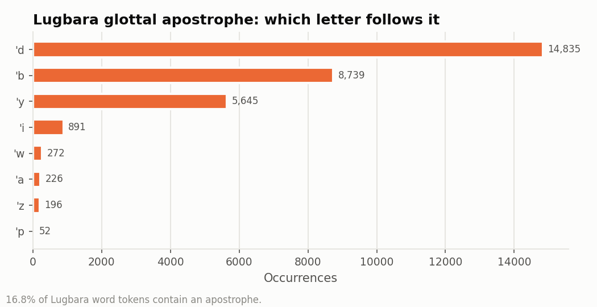
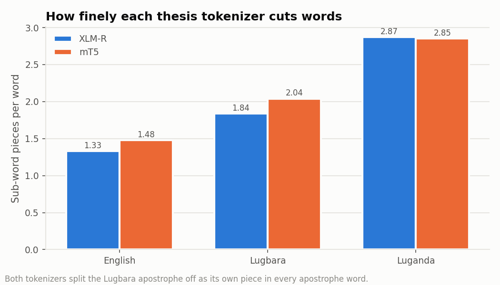

# Lugbara language analysis

Measured on the 15,524 SALT sentences used to train these models (the thesis-sized sample described in the model card). Produced by `lugbara_mt.py analyze`.

## Background

Lugbara (ISO 639-3 `lgg`, Glottolog `lugb1240`) is a Central Sudanic language of the West Nile region of Uganda and the neighbouring north-east of the DR Congo. It is unrelated to Luganda and the other Bantu languages of Uganda. Lugbara is tonal, but tone is not written in everyday spelling. The apostrophe writes a glottal stop and forms the implosive and pre-glottalised consonants `'b`, `'d`, `'y` and `'w` (Akuma, 2025, §2.3.3).

## The sample

|  | Sentences |
|---|---|
| SALT rows (all splits) | 24943 |
| Rows with Lugbara text | 24943 |
| Rows with English, Lugbara and Luganda, after cleaning | 24585 |
| Removed (empty / duplicate / malformed) | 0 / 3 / 355 |
| Sampled (seed 13) | 15524 |
| Train / validation / test | 10867 / 2329 / 2328 |

## Sentence length and vocabulary

| Language | Sentences | Words | Distinct words | Words per sentence | Type/token | Share of words seen once | Word tokens ending in a vowel |
|---|---|---|---|---|---|---|---|
| English | 15524 | 141905 | 9328 | 9.14 | 0.0657 | 0.375 | 0.316 |
| Lugbara | 15524 | 184451 | 10051 | 11.88 | 0.0545 | 0.539 | 0.989 |
| Luganda | 15524 | 113771 | 22716 | 7.33 | 0.1997 | 0.641 | 0.992 |

The same sentences take **11.88 words** in Lugbara, 9.14 in English and 7.33 in Luganda.

### Most frequent Lugbara words

`ma` (11898), `'diyi` (7269), `ni` (4830), `'ba` (4082), `e'yo` (3740), `ba` (3279), `eyi` (3190), `azi` (2921), `eri` (2916), `yi` (2529), `ra` (2421), `ri` (2299), `dria` (1918), `ku` (1520), `le` (1489), `alia` (1478), `alea` (1456), `dri` (1438), `nga` (1348), `fe` (1341), `si` (1317), `niri` (1240), `'da` (1214), `afa` (1209), `be` (1135), `'bani` (1065), `angu` (1060), `eyini` (1044), `amuti` (1019), `kari` (1010), `azini` (970), `azo` (929), `i` (896), `ru` (825), `ama` (811), `anzi` (793), `vile` (771), `ci` (734), `geri` (710), `robia` (686)

## Spelling

* Word tokens containing an apostrophe: **16.8%**
* Apostrophe followed by: `'d` 14835, `'b` 8739, `'y` 5645, `'i` 891, `'w` 272, `'a` 226, `'z` 196, `'p` 52, `'t` 37, `'n` 35
* Apostrophe characters in the raw SALT text (all folded to `'`): U+0027 APOSTROPHE: 29545, U+A78C LATIN SMALL LETTER SALTILLO: 1567
* Letters outside ASCII: `ǝ` 1, `đ` 1
* Most common word-initial consonant clusters: `dr` 6045, `ng` 2684, `nd` 2062, `ny` 1117, `ndr` 646, `mb` 621, `nz` 620, `tr` 451, `mv` 221, `gb` 179, `pr` 148, `kp` 89, `dw` 82, `ch` 62, `kr` 57

## Relationship to English and Luganda

| Pair | Shared top-2,000 words |
|---|---|
| Lugbara Vs English | 5.1% |
| Lugbara Vs Luganda | 4.4% |

## How the thesis models' tokenizers cut Lugbara

| Tokenizer | Pieces/word English | Pieces/word Lugbara | Pieces/word Luganda | Apostrophe words where `'` becomes its own piece |
|---|---|---|---|---|
| XLM-R | 1.33 | 1.84 | 2.87 | 100.0% |
| mT5 | 1.48 | 2.04 | 2.85 | 100.0% |

The thesis kept the apostrophe inside the word when tokenising (§3.2.2). The last column shows how often each pre-trained tokenizer instead cuts it off, which is one reason the model card also reports apostrophe integrity of the output.

## Limits

* SALT sentences are short and mostly about agriculture, health and community life; the thesis corpus also covered tourism and religion.
* Tone is not written, so words that differ only in tone look the same.
* All text is lowercased, as in the thesis.
