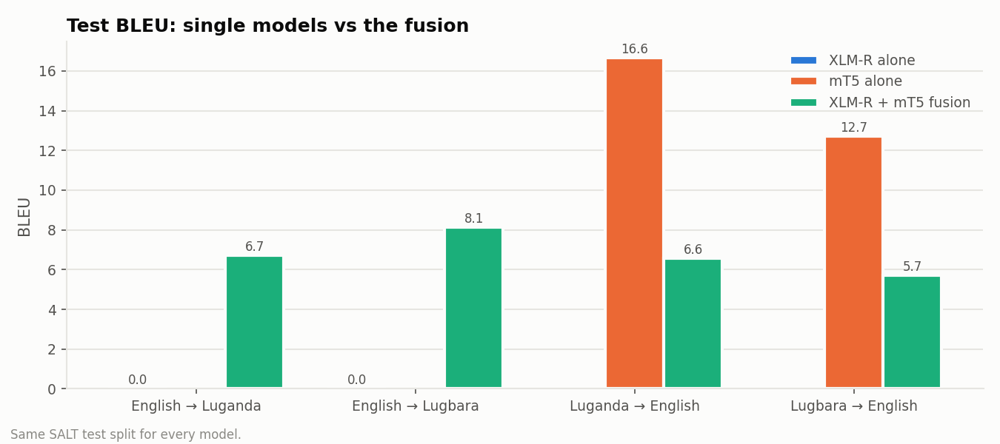
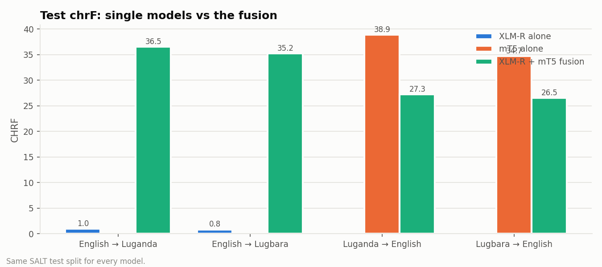
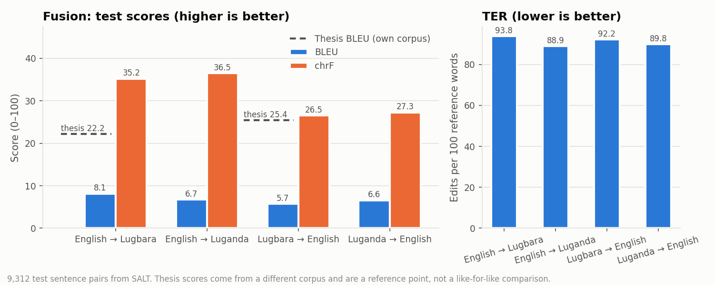
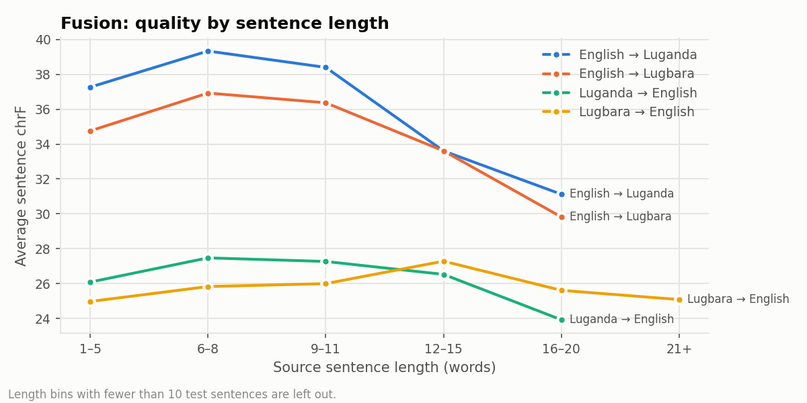
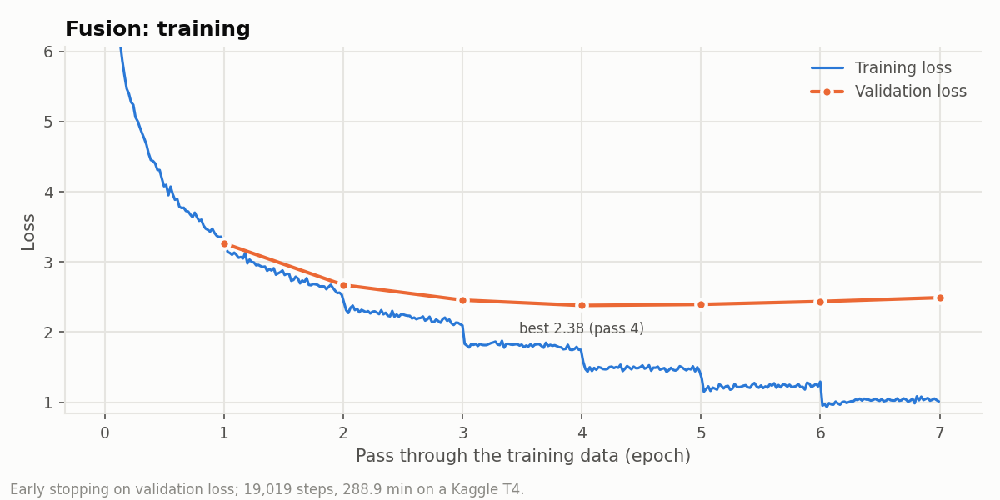

# XLM-R + mT5 fusion translator (English ↔ Lugbara, English ↔ Luganda)

An ensemble of the two models of **C. D. Akuma, *An Optimized Machine Translation Model for
Low-Resource Lugbara Language*, MSc Computer Science, Muni University (October 2025)**. The thesis
found XLM-R best for English→Lugbara and mT5 best for Lugbara→English; this model fuses them into
one network that translates in all four directions.

```
source ──► XLM-R encoder ──► projection + LayerNorm ─┐
      └──► mT5 encoder ──────────────────────────────┴─► joint memory ──► mT5 decoder ──► translation
```

The mT5 decoder attends over the states of **both** encoders at every output word; a learned
source-type vector tells it which encoder each state came from (dual-encoder fusion, cf. Zhu et
al., 2020, *Incorporating BERT into Neural Machine Translation*).

## How to use

The repository holds the two encoders' weights (`mt5/`, `xlmr/`), the fusion layers
(`fusion_head.safetensors`) and the model code (`fusion_mt.py`, `lugbara_mt.py`).

```python
import sys
from huggingface_hub import snapshot_download
d = snapshot_download("ckuma/lugbara-ensemble-translator")
sys.path.insert(0, d)
import fusion_mt

tm, tx, model = fusion_mt.build(from_dir=d)
print(fusion_mt.translate(tm, tx, model, ["<2lgg> farmers should plant early when the rains begin."]))
print(fusion_mt.translate(tm, tx, model, ["<2en> " + "<a lugbara sentence, lowercase>"]))
```

Tags: `<2lgg>` → Lugbara, `<2lug>` → Luganda, `<2en>` → English. Use lowercase input, as in training.

## Results (test split, 9312 sentence pairs)

| Direction | Sentences | BLEU ↑ | TER ↓ | Word F1 ↑ | chrF ↑ | Apostrophe integrity ↑ | BLEU of the single models | Thesis best BLEU* |
|---|---|---|---|---|---|---|---|---|
| English → Lugbara | 2328 | 8.14 | 93.79 | 0.3536 | 35.22 | 0.5545 | 0.0 (XLM-R alone) | 22.18 (XLM-R (tuned)) |
| English → Luganda | 2328 | 6.72 | 88.93 | 0.277 | 36.52 | – | 0.0 (XLM-R alone) | – |
| Lugbara → English | 2328 | 5.72 | 92.17 | 0.2566 | 26.53 | – | 12.71 (mT5 alone) | 25.41 (mT5 (tuned)) |
| Luganda → English | 2328 | 6.57 | 89.84 | 0.2736 | 27.27 | – | 16.65 (mT5 alone) | – |

The single models were trained and scored on exactly the same split. \*Thesis scores were measured on
the thesis's own corpus, not on SALT, so they are a reference point only.












### Sample test translations

**English → Lugbara**

| Source | Reference | Fusion model |
|---|---|---|
| women and girls' voices are often excluded from decision making. | ba erini tutuni o'duko oku eyini azini ezoanzi eyini ri e'yo peta pezu 'diyi ma alea ku | ba e'yo oku eyini 'diyi tuni e'yo 'bani 'ba eyini 'diyi ma dria |
| the cars have to be serviced before they go out to the field. | ba ma 'ye mutukari ma rua e'deta eri 'bazu pa dria 'diyi ra ka de nga fu ni mu amve azia ku | ba ma osu mutukari eyi nga po'di angu 'da ma alea ku |
| some of the government officials in uganda are just appointed into office. | ba lu azi'ba gameteni kari uganda niri ma alea 'diyi ma azi eyini azi fefe | ba azi gamete ni 'diyi ma azi kari uganda niri ma alea 'diyi ma alea |
| the personal protective equipment is heavy and hot. | bongo azi'ba yi ageyi tepiri yini suu ri nzi nzi dika dri dri. | afa 'bani o'bi yini 'diyi ma rua 'diyi 'ba e'yo 'bazu 'diyi pie |
| the task force managed to contain the spread of diseases in the district. | drice'ba azo korona niri ni 'diyi o'bi azo eyi ma ereta distrikitia ri atri ra | ba e'yo 'ba e'yo 'bani 'ba e'yo 'da ma aza kozu distrikitia 'diyi ma alea ra |

**English → Luganda**

| Source | Reference | Fusion model |
|---|---|---|
| women and girls' voices are often excluded from decision making. | amaloboozi g'abakyala n'abaana ab'obuwala emirundi egisinga gaboolebwa mu kukola okusalawo. | abantu abawala n'abawala n'abawala n'abawala ebikwata ku bawala. |
| the cars have to be serviced before they go out to the field. | emmotoka zirina okukolebwa saaviisi nga tezinnatwalibwa kukozesebwa mu mirimu. | emmotoka erina okuteekerateekeddwa nga tebannattikirwa mu nkambi. |
| some of the government officials in uganda are just appointed into office. | abakungu ba gavumenti abamu mu uganda baweebwa buweebwa yafesi. | abakungu ba gavumenti aba gavumenti ba gavumenti abapya. |
| the personal protective equipment is heavy and hot. | ebintu ebikozesebwa okwetangira bizito, byokya era bitaataaganya. | ebintu by'obuyinza eby'obuyonjo eby'obuyonjo. |
| the task force managed to contain the spread of diseases in the district. | akakiiko akalabirizi kaasobola okufufugaza endwadde obutasaasaanira mu disitulikiti. | akakiiko akaddukanya ekirwadde kya disitulikiti mu disitulikiti. |

**Lugbara → English**

| Source | Reference | Fusion model |
|---|---|---|
| ba erini tutuni o'duko oku eyini azini ezoanzi eyini ri e'yo peta pezu 'diyi ma alea ku | women and girls' voices are often excluded from decision making. | pregnant women should be taught how to avoid hiv and stay healthy. |
| ba ma 'ye mutukari ma rua e'deta eri 'bazu pa dria 'diyi ra ka de nga fu ni mu amve azia ku | the cars have to be serviced before they go out to the field. | motorcyclists are not allowed to move out of their cars without contamination. |
| ba lu azi'ba gameteni kari uganda niri ma alea 'diyi ma azi eyini azi fefe | some of the government officials in uganda are just appointed into office. | some ugandans are found guilty of corruption. |
| bongo azi'ba yi ageyi tepiri yini suu ri nzi nzi dika dri dri. | the personal protective equipment is heavy and hot. | employers are not following the rules and regulations. |
| drice'ba azo korona niri ni 'diyi o'bi azo eyi ma ereta distrikitia ri atri ra | the task force managed to contain the spread of diseases in the district. | the number of coronavirus cases in the district is worrying. |

**Luganda → English**

| Source | Reference | Fusion model |
|---|---|---|
| amaloboozi g'abakyala n'abaana ab'obuwala emirundi egisinga gaboolebwa mu kukola okusalawo. | women and girls' voices are often excluded from decision making. | pregnant mothers and childbirth are essential for expectant mothers. |
| emmotoka zirina okukolebwa saaviisi nga tezinnatwalibwa kukozesebwa mu mirimu. | the cars have to be serviced before they go out to the field. | the vehicle that knocked him down should be checked for further investigations. |
| abakungu ba gavumenti abamu mu uganda baweebwa buweebwa yafesi. | some of the government officials in uganda are just appointed into office. | some government officials have been suspended in uganda. |
| ebintu ebikozesebwa okwetangira bizito, byokya era bitaataaganya. | the personal protective equipment is heavy and hot. | according to the findings, the truth eventually, the problem is a recurring theme. |
| akakiiko akalabirizi kaasobola okufufugaza endwadde obutasaasaanira mu disitulikiti. | the task force managed to contain the spread of diseases in the district. | the task force has to stop the spread of diseases in the district. |

## Training

* **Data:** 10,867 / 2,329 / 2,328
  sentences (train / validation / test) drawn at random (seed 13) from Sunbird SALT, the
  thesis's 15,524-sentence, 70/15/15 design; every sentence is used in all four directions.
* **Learning rates:** mT5 and the fusion layers 0.001 (mT5's grid-search winner);
  XLM-R 3e-05 (XLM-R's grid-search winner); Adafactor; XLM-R's word embeddings frozen.
* **Training:** batch 16, early stopping on validation loss (patience 3),
  19,019 steps, 288.9 minutes on a Kaggle T4;
  860M parameters (668M trained).

See [LUGBARA_ANALYSIS.md](LUGBARA_ANALYSIS.md) for the Lugbara language analysis of the training data.

## Limits

* Short SALT sentences (agriculture, health, community life); other domains are weaker.
* Lowercase only; Lugbara tone is not written, so tone-only differences are lost.
* Automatic scores use one reference per sentence; Lugbara speakers should review output before use.

## Credits

Thesis and method: Charity Driciru Akuma, Muni University (2025) · Data: Sunbird AI, SALT (CC BY-SA 4.0)
· Base models: `google/mt5-base`, `FacebookAI/xlm-roberta-base` · Earlier work: [mmuniversity/rutooro-multilingual-translator](https://huggingface.co/mmuniversity/rutooro-multilingual-translator).
