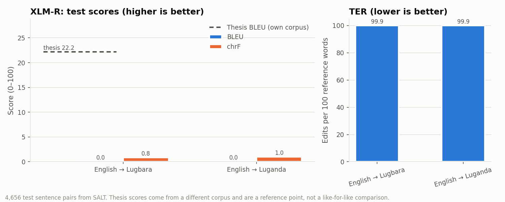
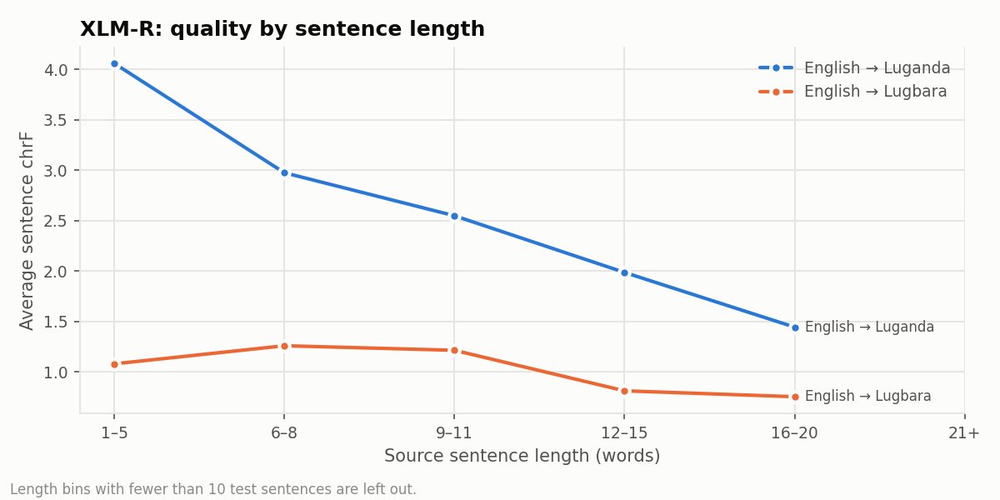
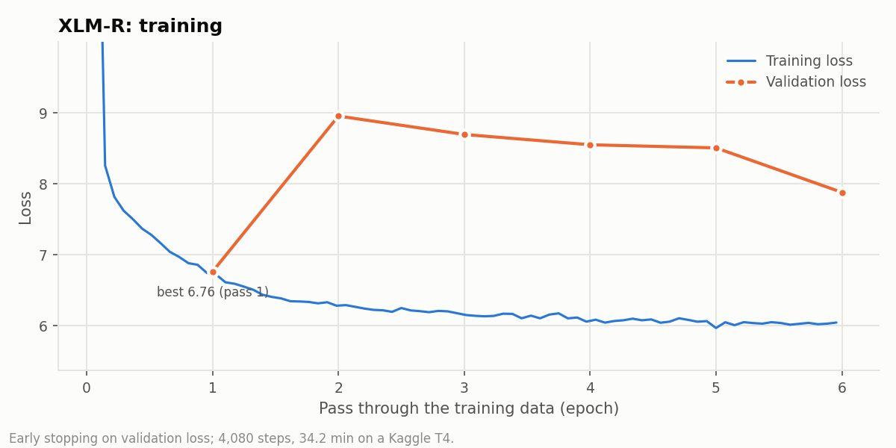
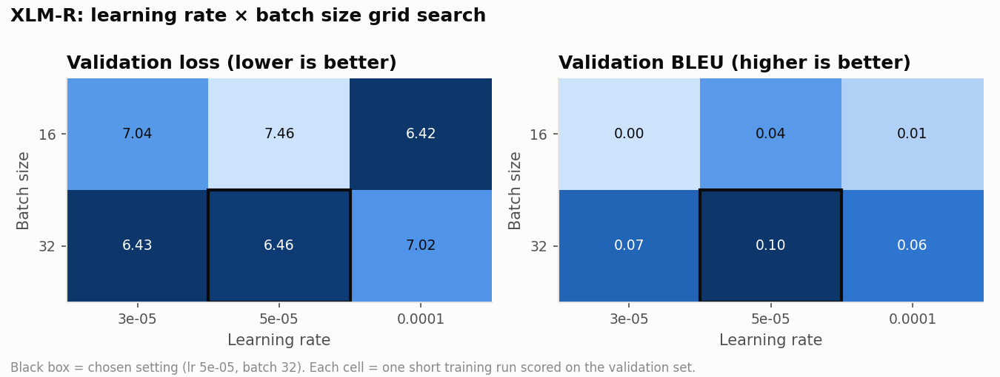

# XLM-R English→Lugbara/Luganda translator

Fine-tuned `FacebookAI/xlm-roberta-base` for English → Lugbara, English → Luganda.
It follows the model choice and training method of **C. D. Akuma, *An Optimized Machine
Translation Model for Low-Resource Lugbara Language*, MSc Computer Science, Muni University
(October 2025)**: XLM-R was the thesis's optimised English→Lugbara model.

## How to use

Put the target-language tag in front of the sentence and use lowercase text, as in training.

```python
from transformers import AutoTokenizer, AutoModelForSeq2SeqLM

tok = AutoTokenizer.from_pretrained("ckuma/lugbara-multilingual-translator")
model = AutoModelForSeq2SeqLM.from_pretrained("ckuma/lugbara-multilingual-translator")

def translate(text, tag):
    x = tok(tag + " " + text.lower(), return_tensors="pt")
    y = model.generate(**x, num_beams=4, max_new_tokens=128)
    return tok.decode(y[0], skip_special_tokens=True)

print(translate("women and girls' voices are often excluded from decision making.", "<2lgg>"))
print(translate("the cars have to be serviced before they go out to the field.", "<2lgg>"))
```

Tags: `<2lgg>` for English → Lugbara, `<2lug>` for English → Luganda.

## Results (test split, 4656 sentence pairs)

| Direction | Sentences | BLEU ↑ | TER ↓ | Word F1 ↑ | chrF ↑ | Apostrophe integrity ↑ | Thesis best BLEU* |
|---|---|---|---|---|---|---|---|
| English → Lugbara | 2328 | 0.0 | 99.94 | 0.0016 | 0.85 | 0.0035 | 22.18 (XLM-R (tuned)) |
| English → Luganda | 2328 | 0.0 | 99.88 | 0.0047 | 0.96 | – | – |

BLEU and TER are sacreBLEU corpus scores; word F1 is unigram precision/recall F1; apostrophe
integrity is the share of apostrophe words in the reference (`'ba`, `a'dule` …) reproduced intact.
\*The thesis scores were measured on the thesis's own corpus, not on SALT, so they are a
reference point rather than a like-for-like comparison.










### Sample test translations (English → Lugbara)

| Source | Reference | Model |
|---|---|---|
| women and girls' voices are often excluded from decision making. | ba erini tutuni o'duko oku eyini azini ezoanzi eyini ri e'yo peta pezu 'diyi ma alea ku |  |
| the cars have to be serviced before they go out to the field. | ba ma 'ye mutukari ma rua e'deta eri 'bazu pa dria 'diyi ra ka de nga fu ni mu amve azia ku |  |
| some of the government officials in uganda are just appointed into office. | ba lu azi'ba gameteni kari uganda niri ma alea 'diyi ma azi eyini azi fefe | diyi |
| the personal protective equipment is heavy and hot. | bongo azi'ba yi ageyi tepiri yini suu ri nzi nzi dika dri dri. | diyi |
| the task force managed to contain the spread of diseases in the district. | drice'ba azo korona niri ni 'diyi o'bi azo eyi ma ereta distrikitia ri atri ra |  |
| the area is out of bounds. | pari ndea 'ba leni 'ba ma ca ku |  |
| what could be the hindrances to the future development of youths? | e'yo ecopi 'ba ode eyi ma zota ewu drialeri ma alea ri atri pi ra 'diyi a'duni? | e |
| my grandfather died when he was eighty eight years old. | ma a'bi dra de eri ma eli kali aro drini aro. |  |

## Training

* **Data:** the thesis corpus (15,524 English–Lugbara pairs) is not public, so the same number
  of sentences was drawn at random (seed 13) from the cleaned [Sunbird SALT](https://huggingface.co/datasets/Sunbird/salt)
  `text-all` table and split 70/15/15 like the thesis: 10,867 train,
  2,329 validation, 2,328 test. Luganda uses
  the same sentences. SALT has no domain labels, so the split is random rather than stratified by domain.
* **Preprocessing (thesis §3.2.2):** lowercased, punctuation normalised, all apostrophe variants
  folded to `'`, empty / duplicate / malformed pairs removed.
* **Model:** encoder-decoder warm-started from XLM-R base (Rothe et al., 2020), encoder and decoder weights shared.
* **Hyperparameters (thesis §3.4.3):** grid search over learning rate × batch size
  (3e-05/16 → 0.0 BLEU, 3e-05/32 → 0.07 BLEU, 5e-05/16 → 0.04 BLEU, 5e-05/32 → 0.1 BLEU, 0.0001/16 → 0.01 BLEU, 0.0001/32 → 0.06 BLEU),
  then fine-tuning with lr 5e-05, batch 32, optimiser adamw_torch,
  early stopping on validation loss (patience 5); 4,080 steps,
  34.2 minutes on a Kaggle GPU.

* Version 2: grid settings compared after 2 passes instead of 1; the cross-attention layers (new, randomly initialised) learn at 10x the grid learning rate; label smoothing 0.1; early-stopping patience 5; repeated 3-word phrases are blocked when generating. Version 1 (1-pass grid, patience 3, no repeat blocking) stopped at validation loss 4.46 and scored BLEU 0.29 / 0.16 because its output looped.

See [LUGBARA_ANALYSIS.md](LUGBARA_ANALYSIS.md) for the Lugbara language analysis of the training data.

## Limits

* Trained on short SALT sentences (agriculture, health, community life); other domains are weaker.
* Lowercase only. Tone is not written in Lugbara, so tone-only differences are lost.
* Automatic scores use one reference per sentence; Lugbara speakers should review output before use.

## Credits

* Thesis and method: Charity Driciru Akuma, Muni University (2025).
* Data: Sunbird AI, SALT (CC BY-SA 4.0).
* Base model: `FacebookAI/xlm-roberta-base`.
* Earlier work: [mmuniversity/rutooro-multilingual-translator](https://huggingface.co/mmuniversity/rutooro-multilingual-translator) (Mountains of the Moon University).
